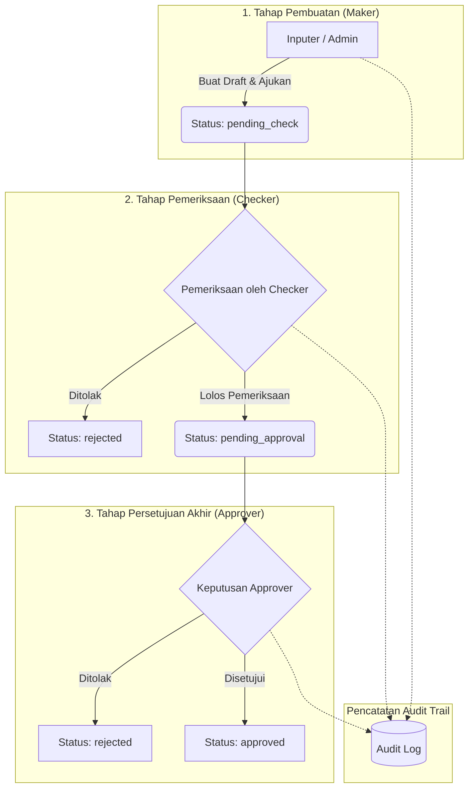

# Konsep Segregation of Duties (SoD) dalam Sistem Enterprise

Dokumen ini mendokumentasikan prinsip, arsitektur, dan penerapan konsep **Segregation of Duties (SoD)** atau **Pemisahan Kewenangan** pada **RBAC Approval System**.

---

## 1. Definisi & Urgensi Segregation of Duties (SoD)

**Segregation of Duties (SoD)** adalah prinsip dasar tata kelola teknologi informasi dan kontrol internal enterprise (mengacu pada standar COSO dan ISO/IEC 27001) yang memastikan bahwa:

> **Tidak ada satu individu pun yang memiliki kontrol penuh dari awal hingga akhir atas suatu transaksi bisnis yang bersifat kritis.**

### Tujuan Utama Penerapan SoD:
1. **Mencegah Fraud & Kecurangan:** Mengeliminasi peluang manipulasi data transaksi secara sepihak.
2. **Mencegah Human Error:** Verifikasi berjenjang memastikan data yang salah atau tidak lengkap dapat terdeteksi sebelum dieksekusi.
3. **Mencegah Konflik Kepentingan (Conflict of Interest):** Pembuat transaksi dilarang mengesahkan transaksinya sendiri.
4. **Menjamin Akuntabilitas:** Setiap tahapan memiliki penanggung jawab yang tercatat secara transparan pada Audit Trail.

---

## 2. Prinsip Dual Control / Four-Eyes Principle

Dalam sistem ini, alur transaksi menerapkan model **Maker-Checker-Approver** (Prinsip Dual Control / Empat Mata):

1. **Maker (Inputer):** Bertugas menginput rincian transaksi (nomor transaksi, nominal, deskripsi). Transaksi berstatus awal `draft` dan beralih ke `pending_check` setelah diajukan.
2. **Checker:** Bertugas memverifikasi kelayakan data transaksi. Checker dapat meloloskan transaksi (`pending_approval`) atau menolaknya (`rejected`) disertai catatan alasan penolakan (`rejection_note`).
3. **Approver:** Pejabat berwenang yang memberikan keputusan akhir (`approved` atau `rejected`).

---

## 3. Matriks Pemisahan Tugas (Role Matrix)

Sistem membedakan kewenangan operasional bisnis dengan kewenangan tata kelola akun:

| Role | Kelola Pengguna | Buat Transaksi | Periksa Transaksi | Setujui Transaksi | Override / Hapus Transaksi | Lihat Audit Log |
| :--- | :---: | :---: | :---: | :---: | :---: | :---: |
| **Superadmin** | ✅ Ya | ✅ Ya | ❌ Dibatasi (Bypass Khusus) | ❌ Dibatasi (Bypass Khusus) | ✅ Ya | ✅ Ya |
| **Admin** | ✅ Ya | ✅ Ya | ❌ Tidak | ❌ Tidak | ✅ Ya | ✅ Ya |
| **Inputer** | ❌ Tidak | ✅ Ya | ❌ Tidak | ❌ Tidak | ⚠️ Hanya Draft Sendiri | ❌ Tidak |
| **Checker** | ❌ Tidak | ❌ Tidak | ✅ Ya | ❌ Tidak | ❌ Tidak | ❌ Tidak |
| **Approver** | ❌ Tidak | ❌ Tidak | ❌ Tidak | ✅ Ya | ❌ Tidak | ❌ Tidak |
| **User** | ❌ Tidak | ❌ Tidak | ❌ Tidak | ❌ Tidak | ❌ Tidak | ❌ Tidak |

> **Catatan Kritis SoD:**
> Admin dan Superadmin memiliki wewenang mengelola pengguna dan mengoreksi data, namun secara tata kelola **tidak diberikan role Checker atau Approver secara langsung** untuk transaksi operasional rutin, guna mencegah benturan wewenang (*segregation of administrative vs operational duties*).

---

## 4. Pencegahan Konflik Kepentingan

1. **Self-Approval Prohibition (Larangan Persetujuan Mandiri):**
   Pengguna yang bertindak sebagai Inputer tidak boleh bertindak sebagai Checker maupun Approver pada transaksi yang ia buat sendiri.
2. **Checker-Approver Separation:**
   Pengguna yang telah memeriksa transaksi sebagai Checker tidak boleh merangkap sebagai Approver pada transaksi yang sama.
3. **Dual Control Protection:**
   Perubahan status transaksi hanya dapat berpindah sesuai state machine yang valid (`draft` $\rightarrow$ `pending_check` $\rightarrow$ `pending_approval` $\rightarrow$ `approved` / `rejected`).

---

## 5. Akuntabilitas & Audit Trail

Setiap perpindahan tahapan dan tindakan pengguna dicatat ke dalam tabel `audit_logs` secara otomatis dengan informasi:
- **User ID & Nama:** Siapa yang melakukan aksi.
- **Action Type:** Tipe aksi (contoh: `CREATE_TRANSACTION`, `CHECK_TRANSACTION`, `APPROVE_TRANSACTION`, `REJECT_BY_CHECKER`, dll).
- **Description:** Ringkasan konteks, nominal transaksi, dan alasan penolakan bila ada.
- **Timestamp:** Waktu tepat terjadinya tindakan.
